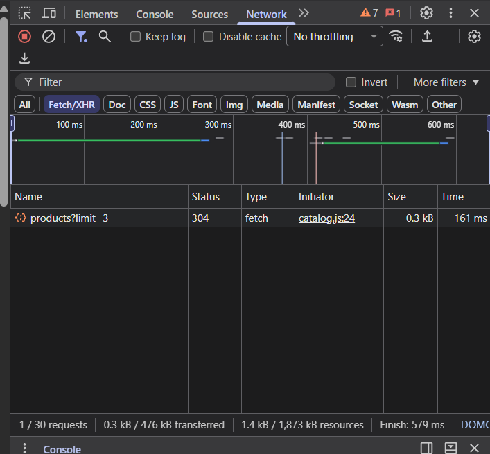
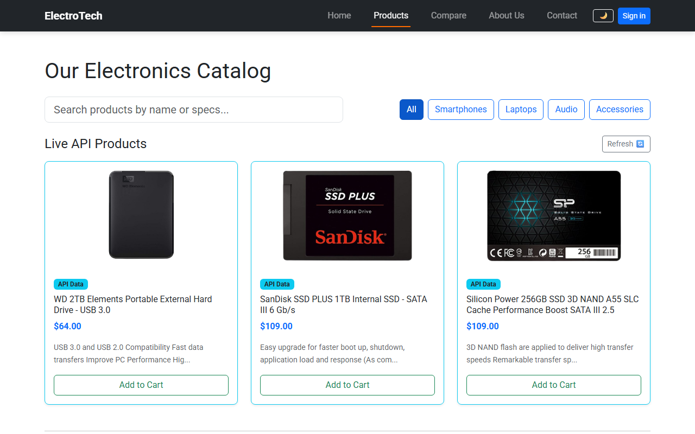
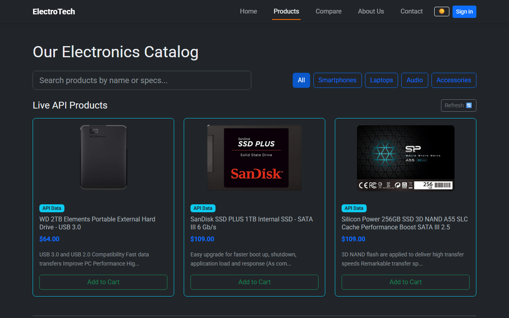

# Final Project Report — ElectroTech Store

## 1. Project Overview & Objectives
- **Project Name:** ElectroTech — Electronics Store
- **Topic:** A responsive and interactive online electronics store.
- **GitHub Repository:** [https://github.com/emirbakizhanov-byte/midtermWEB](https://github.com/emirbakizhanov-byte/midtermWEB)
- **Live Deployed Website:** [https://emirbakizhanov-byte.github.io/midtermWEB/](https://emirbakizhanov-byte.github.io/midtermWEB/)

### Project Description & Evolution
ElectroTech is a multi-page e-commerce web application. 
- **Midterm Version:** Built as a static, responsive website with HTML, CSS, and Bootstrap, featuring five core pages, a responsive navigation bar, product cards, a comparison table, and a contact form with basic validation.
- **Endterm Version:** Extended with JavaScript and jQuery features: real-time form validation with a password strength indicator, live search combined with category filters, a full CRUD product table stored in `localStorage`, and a jQuery lightbox image gallery.
- **Final Version:** Added a light/dark theme toggle saved in `localStorage`, a sign-in / sign-out system with form validation and `localStorage`, a jQuery FAQ section with `.slideToggle()`, and an **External API Integration** (`fetch()`) with loading state, refresh button, and error handling.

---

## 2. Website Architecture & File Structure
- **`index.html`** — Home page with promotional blocks and layout structure.
- **`products.html`** — Product catalog featuring static items, category filters, live search, Lightbox image viewer, and dynamically fetched live API products.
- **`compare.html`** — Product comparison and interactive inventory table with full CRUD operations.
- **`about.html`** — Company information and team member profiles.
- **`contact.html`** — Customer support page and registration form with real-time client-side validation (`js/validation.js`).
- **`css/style.css`** — Custom styling, Flexbox/Grid layouts, and responsive media queries.
- **`js/` (JavaScript & jQuery Modules):**
  - `catalog.js` — External public API integration (`fetch()`), JSON parsing, error handling, live search, category filtering, and Lightbox gallery navigation.
  - `validation.js` — Real-time registration form validation, RegEx email checks, and password strength evaluation.
  - `table.js` — Dynamic product inventory table with CRUD operations (Add, View, Edit, Delete) and `localStorage` persistence.
  - `script.js` — Shared utility scripts, including the animated "back to top" button.
  - `theme.js` — Light/dark theme toggle; the selected theme is saved in `localStorage` and applied on every page.
  - `auth.js` — Sign-in form validation, saving the signed-in user (name and email only) in `localStorage`, signed-in navbar and greeting, and sign-out.
  - `faq.js` — FAQ answers that open and close with jQuery `.slideToggle()` and a + / − indicator.
- **`.github/workflows/pages.yml`** — CI/CD workflow configuration for automated deployment to GitHub Pages.

---

## 3. Team Member Contributions

| Group Member | Midterm Contribution | Endterm Contribution | Final Project Contribution |
| --- | --- | --- | --- |
| **Student 1 — Emir Bakizhanov** | Semantic HTML structure and content for the home page, product catalog, and comparison table (`index.html`, `products.html`, `compare.html`); product images, links, and lazy loading. | Registration form with client-side validation: required fields, RegEx email check, password strength indicator, and password confirmation (`contact.html`, `js/validation.js`); shared "back to top" script (`js/script.js`). | **External API Integration via `fetch()`**: JSON data processing, loading indicator, refresh button, and network error handling (`products.html`, `js/catalog.js`); project report and screenshots (`Report.md`, `screenshots/`). |
| **Student 2 — Isatay Makhambetuly** | Shared CSS variables and styling, Flexbox navigation, Grid/Flexbox layouts, sticky header, team cards, and interaction states (`about.html`, `css/style.css`). | Real-time product search, category filter buttons, and the image gallery with a jQuery lightbox (`products.html`, `js/catalog.js`, `css/style.css`). | **jQuery FAQ section**: five questions with `.slideToggle()` animation and + / − indicators; unified page layouts and CSS variables (`about.html`, `js/faq.js`, `css/style.css`). |
| **Student 3 — Arlan Narushev** | Bootstrap contact form and validation, responsive Bootstrap grid and navigation across all five pages, tablet/mobile media queries, and GitHub Pages deployment (`contact.html`, all pages, `css/style.css`, `.github/workflows/pages.yml`). | Dynamic product inventory table with full CRUD operations: add, view, edit, and delete with confirmation (`compare.html`, `js/table.js`, `css/style.css`). | **Light/Dark theme toggle** saved in `localStorage`; **Sign-in / Sign-out** with form validation, `localStorage`, and a signed-in interface (`js/theme.js`, `js/auth.js`, all pages, `css/style.css`); README, GitHub Pages deployment, and commit history (`README.md`). |

---

## 4. Technical Implementation: External API & Error Handling
To fulfill the advanced API requirements, the product catalog (`products.html`) integrates the public **Fake Store API** (`https://fakestoreapi.com/products/category/electronics?limit=3`):

1. **Asynchronous Requests (`fetch()`):** Retrieves live product data in JSON format asynchronously using `async/await`.
2. **Dynamic UI Rendering:** Converts incoming JSON payloads into responsive Bootstrap cards dynamically injected into `#apiProductList`.
3. **Robust Error Handling & UX:**
  - **Loading State:** Displays an animated Bootstrap spinner while data is being fetched.
  - **HTTP & Network Validation:** Verifies `response.ok` status codes and wraps requests in `try...catch` blocks to seamlessly handle disconnections, CORS issues, or server errors.
  - **User Feedback:** Displays a descriptive warning banner (`#apiStatusMessage`) if the network fails, and provides an interactive refresh button (`#reloadApiBtn`) to retry loading data.
4. **User Interaction:** The "Refresh" button loads the data again, and the catalog search bar also filters the API products by title.

---

## 5. Technical Implementation: Theme, Sign-in & FAQ

1. **Light/Dark Theme (`js/theme.js`):** The navbar button switches the `data-bs-theme` attribute on the `<html>` element between `light` and `dark`. Bootstrap 5.3 recolors its components from this attribute, and `css/style.css` redefines the site's own CSS variables for the dark theme. The choice is saved in `localStorage` and read again on every page load; the script is loaded in `<head>` so the saved theme is applied before the page is displayed.
2. **Sign-in / Sign-out (`js/auth.js`):** The sign-in form (Bootstrap modal available on every page) validates the name (2–30 letters), the email (regular expression), and the password (at least 6 characters), and shows an error under each invalid field. On success only the name and email are saved in `localStorage` as JSON; the password is never stored. On every page load the script reads this data and shows either the "Sign in" button or "Hi, *name*" with a "Sign out" button, plus a greeting on the home page. "Sign out" removes the saved user.
3. **FAQ (`js/faq.js`):** Clicking a question toggles its answer with jQuery `.slideToggle()`, closes the previously opened answer, and switches the indicator between + and −.

---

## 6. Development Process

- The project was developed in one shared GitHub repository from the midterm to the final; each stage extended the same website instead of starting over.
- Every member implemented their features in their own commits, so the commit history shows each person's contribution.
- Features were tested in the browser on desktop and mobile widths and in both themes.
- Every push to `main` is deployed automatically to GitHub Pages by a GitHub Actions workflow (`.github/workflows/pages.yml`), and the API was checked on the deployed website.

---

## 7. Screenshots & Verification

### 1. API Integration & Network Request

### 2. UI Themes (Light & Dark Mode)
| Light Mode | Dark Mode |
| :---: | :---: |
|  |  |

### 3. Responsive Mobile View

---

## 8. AI Usage Acknowledgment
In accordance with the **Final Project Requirements (Section 6: AI Usage Policy)**, we formally disclose the use of artificial intelligence during project development:
- **AI Tool Used:** Google Gemini.
- **Scope of Use:** Used as a supporting assistant for structuring the asynchronous `fetch()` error-handling logic, refining JavaScript syntax, and drafting technical documentation.
- **Verification:** All code suggestions and documentation structures were thoroughly reviewed, tested, and verified by the team members. Proper attribution has also been integrated into the website footer.