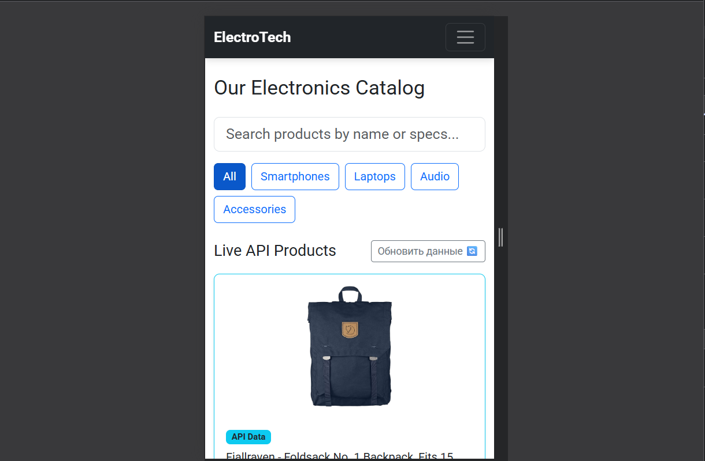

# Final Project Report — ElectroTech Store

## 1. Project Overview & Objectives
- **Project Name:** ElectroTech — Electronics Store[cite: 3]
- **Topic:** A responsive and interactive online electronics store[cite: 3].
- **GitHub Repository:** [https://github.com/emirbakizhanov-byte/midtermWEB.git](https://github.com/emirbakizhanov-byte/midtermWEB.git)[cite: 3]
- **Live Deployed Website:** [https://emirbakizhanov-byte.github.io/midtermWEB/](https://emirbakizhanov-byte.github.io/midtermWEB/)[cite: 3]

### Project Description & Evolution
ElectroTech is a multi-page e-commerce web application[cite: 3]. 
- **Midterm Version:** Built as a static, responsive website with HTML, CSS, and Bootstrap, featuring five core pages, a responsive navigation bar, product cards, a comparison table, and a contact form with basic validation[cite: 3].
- **Endterm & Final Extension:** Extended with advanced JavaScript and jQuery features, including real-time form validation with password strength indicators, dynamic live search combined with category filters, a full CRUD product table stored in `localStorage`, a jQuery lightbox image gallery[cite: 3], and an asynchronous **External API Integration** (`fetch()`) with comprehensive error handling.

---

## 2. Website Architecture & File Structure
- **`index.html`** — Home page with promotional blocks and layout structure[cite: 3].
- **`products.html`** — Product catalog featuring static items, category filters, live search, Lightbox image viewer, and dynamically fetched live API products[cite: 3].
- **`compare.html`** — Product comparison and interactive inventory table with full CRUD operations[cite: 3].
- **`about.html`** — Company information and team member profiles[cite: 3].
- **`contact.html`** — Customer support page and registration form with real-time client-side validation (`js/validation.js`)[cite: 3].
- **`css/style.css`** — Custom styling, Flexbox/Grid layouts, and responsive media queries[cite: 3].
- **`js/` (JavaScript & jQuery Modules):**
  - `catalog.js` — External public API integration (`fetch()`), JSON parsing, error handling, live search, category filtering, and Lightbox gallery navigation[cite: 3].
  - `validation.js` — Real-time registration form validation, RegEx email checks, and password strength evaluation[cite: 3].
  - `table.js` — Dynamic product inventory table with CRUD operations (Add, View, Edit, Delete) and `localStorage` persistence[cite: 3].
  - `script.js` — Shared utility scripts, including the animated "back to top" button[cite: 3].
  - `theme.js` & `faq.js` — Theme switching and FAQ interactivity.
- **`.github/workflows/pages.yml`** — CI/CD workflow configuration for automated deployment to GitHub Pages[cite: 3].

---

## 3. Team Member Contributions (Midterm & Endterm)

| Group Member | Midterm Contribution | Endterm & Final Project Contribution |
| --- | --- | --- |
| **Student 1 — Emir Bakizhanov** | Semantic HTML structure and content for the home page, product catalog, and comparison table (`index.html`, `products.html`, `compare.html`); product images, links, and lazy loading[cite: 3]. | Registration form with client-side validation: required fields, RegEx email check, password strength indicator, and password confirmation (`contact.html`, `js/validation.js`); shared "back to top" script (`js/script.js`)[cite: 3]. |
| **Student 2 — Isatay Makhambetuly** | Shared CSS variables and styling, Flexbox navigation, Grid/Flexbox layouts, sticky header, team cards, and interaction states (`about.html`, `css/style.css`)[cite: 3]. | Real-time product search, category filter buttons, and the image gallery with a jQuery lightbox (`products.html`, `js/catalog.js`, `css/style.css`)[cite: 3]. |
| **Student 3 — Arlan Narushev** | Bootstrap contact form and validation, responsive Bootstrap grid and navigation across all five pages, tablet/mobile media queries, and GitHub Pages deployment (`contact.html`, all pages, `css/style.css`, `.github/workflows/pages.yml`)[cite: 3]. | Dynamic product inventory table with full CRUD operations (add, view, edit, and delete with confirmation) (`compare.html`, `js/table.js`, `css/style.css`)[cite: 3]; **External API Integration via `fetch()`**, JSON data processing, loading indicators, manual refresh controls, and robust network error handling (`products.html`, `js/catalog.js`). |

---

## 4. Technical Implementation: External API & Error Handling
To fulfill the advanced API requirements, the product catalog (`products.html`) integrates the public **Fake Store API** (`https://fakestoreapi.com/products/category/electronics?limit=3`)[cite: 3]:

1. **Asynchronous Requests (`fetch()`):** Retrieves live product data in JSON format asynchronously using `async/await`.
2. **Dynamic UI Rendering:** Converts incoming JSON payloads into responsive Bootstrap cards dynamically injected into `#apiProductList`.
3. **Robust Error Handling & UX:**
  - **Loading State:** Displays an animated Bootstrap spinner while data is being fetched.
  - **HTTP & Network Validation:** Verifies `response.ok` status codes and wraps requests in `try...catch` blocks to seamlessly handle disconnections, CORS issues, or server errors.
  - **User Feedback:** Displays a descriptive warning banner (`#apiStatusMessage`) if the network fails, and provides an interactive refresh button (`#reloadApiBtn`) to retry loading data.

---

## 5. Screenshots & Verification

### 1. API Integration & Network Request
[cite: 4, 9]

### 2. UI Themes (Light & Dark Mode)
| Light Mode | Dark Mode |
| :---: | :---: |
| [cite: 6, 9] | [cite: 5, 9] |

### 3. Responsive Mobile View
[cite: 7, 9]

---

## 6. AI Usage Acknowledgment
In accordance with the **Final Project Requirements (Section 6: AI Usage Policy)**, we formally disclose the use of artificial intelligence during project development:
- **AI Tool Used:** Google Gemini.
- **Scope of Use:** Used as a supporting assistant for structuring the asynchronous `fetch()` error-handling logic, refining JavaScript syntax, and drafting technical documentation.
- **Verification:** All code suggestions and documentation structures were thoroughly reviewed, tested, and verified by the team members. Proper attribution has also been integrated into the website footer.